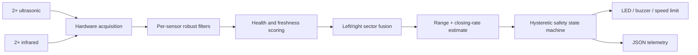

# Autonomous Sensor Fusion Navigation System

[](https://github.com/adheeshram/Autonomous-Sensor-Fusion-Navigation-System/actions/workflows/ci.yml)

A resource-conscious embedded navigation stack that combines ultrasonic and infrared ranging to detect obstacles, estimate approach risk, and produce fail-safe motion guidance on Arduino-class hardware.

Version 3 separates hardware I/O from a portable C++ navigation core. The same filtering, fusion, health monitoring, and decision logic that runs on the microcontroller is compiled and tested natively in CI.

## What the system does

- Rejects impulsive noise with a rolling median, median-absolute-deviation gate, and exponential smoothing.
- Tracks sensor health over time, down-weights unreliable channels, and ignores stale measurements.
- Fuses each left/right sensor pair using modality reliability, health, and freshness weights.
- Preserves the closest occupied sector instead of averaging a dangerous near obstacle into the background.
- Estimates closing speed and time to collision (TTC), allowing the controller to react before a fixed distance threshold is crossed.
- Applies a hysteretic `CLEAR → CAUTION → EMERGENCY` safety state machine with a fail-safe `DEGRADED` mode.
- Emits newline-delimited JSON telemetry for replay and offline analysis.

## Architecture



The core uses fixed-size buffers and no heap allocation. Four seven-sample filter windows use approximately 112 bytes for measurement storage, keeping the design suitable for an ATmega328P-class board. See [architecture.md](docs/architecture.md) for the data flow and design rationale.

## Safety states

| State | Entry condition | Recommended output |
|---|---|---|
| `CLEAR` | Valid estimate beyond caution limits | 100% speed limit, alert off |
| `CAUTION` | Range ≤ 60 cm or TTC ≤ 2.5 s | 45% speed limit, intermittent alert |
| `EMERGENCY` | Range ≤ 25 cm or TTC ≤ 0.8 s | 0% speed limit, continuous alert |
| `DEGRADED` | Estimate missing or confidence < 0.22 | 25% speed limit, fault alert |

Escalation is immediate. De-escalation requires three consecutive readings beyond the active threshold plus an 8 cm release margin, which prevents state chatter around a boundary. These defaults are centralized in [`Config.h`](include/navigation/Config.h).

## Hardware

- Arduino Uno or compatible ATmega328P board
- 2× HC-SR04 ultrasonic sensors
- 2× analog Sharp-style IR distance sensors
- Active/passive buzzer and status LED
- Appropriate resistors, power supply, breadboard, and wiring

The default pin map and electrical notes are in [hardware.md](docs/hardware.md). The IR conversion curve in `src/main.cpp` is an approximation and should be calibrated for the exact sensor model before real-world use.

## Build and test

### Firmware with PlatformIO

```bash
pio run -e uno
pio run -e uno -t upload
pio device monitor -b 115200
```

### Portable core with CMake

```bash
cmake -S . -B build
cmake --build build
ctest --test-dir build --output-on-failure
```

The native suite covers robust filtering, health recovery, sensor dropout, directional fusion, transition hysteresis, TTC-based escalation, and degraded-mode behavior. GitHub Actions runs both the native suite and an Arduino Uno firmware build on every push and pull request.

## Telemetry and replay

Firmware output is JSON Lines, so every cycle can be stored without a custom decoder:

```json
{"t_ms":1250,"sensors_cm":[41.2,83.0,43.5,80.4],"health":[1.00,1.00,0.97,0.95],"distance_cm":42.2,"confidence":0.88,"state":"CAUTION","direction":"LEFT","ttc_s":1.74,"speed_limit_pct":45}
```

Capture and summarize a run:

```bash
pio device monitor -b 115200 | tee run.jsonl
python3 tools/analyze_telemetry.py run.jsonl --csv run.csv
```

The analyzer reports cycle timing, state occupancy, minimum range, confidence, sensor availability, and TTC events, and can flatten valid records to CSV for plotting.

## Repository layout

```text
include/navigation/   Portable interfaces and configuration
src/                  Navigation core and Arduino hardware adapter
test/native/          Host-compiled behavioral tests
tools/                Telemetry analysis utility
docs/                 Architecture, hardware, and validation notes
.github/workflows/    Native test and firmware-build CI
test_results.csv      Original bench observations retained as project history
```

## Validation status

The software paths above are automatically tested, but this repository is not a certified safety controller. The historical observations in `test_results.csv` are retained from the original project; new hardware claims should be added only after a documented bench run. A repeatable test protocol is provided in [validation.md](docs/validation.md).

## License

MIT — see [LICENSE](LICENSE).
